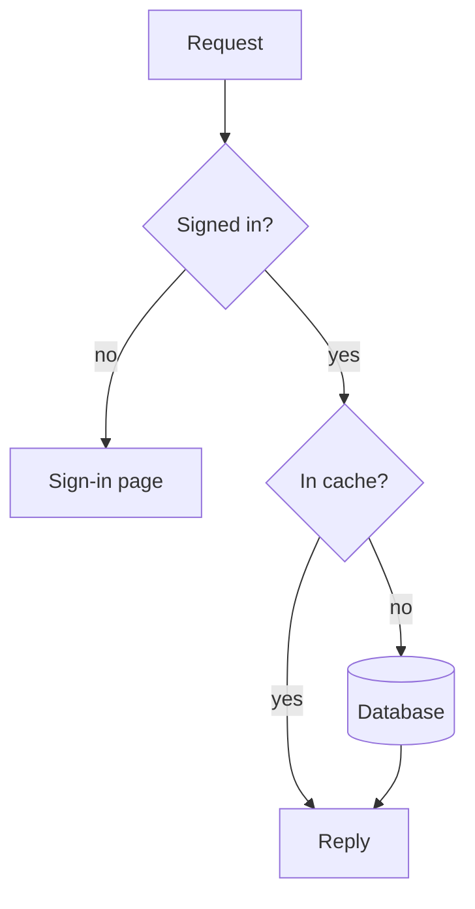
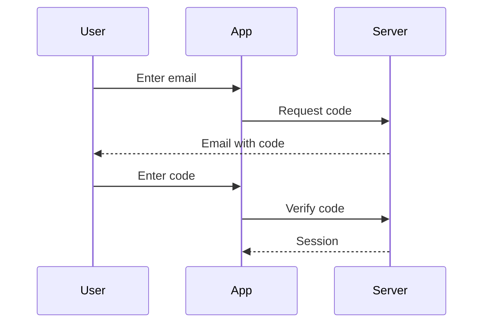

# Mermaid diagrams

A ```mermaid block in your reply renders as a diagram, drawn line by line as you write it. The renderer lays it out, so you write only the structure — nodes, edges, labels — and never a coordinate. That makes it the right block for diagram kinds whose layout every reader already expects; it is the wrong one when the arrangement itself is the point (see the table in `SKILL.md`).

## When to write one

| The question | Diagram |
|---|---|
| What happens, with branches or loops | `flowchart` |
| Who sends what to whom, in what order | `sequenceDiagram` |
| Which states, and what moves between them | `stateDiagram-v2` |
| Which things exist and how they relate | `erDiagram`, `classDiagram` |
| What happens when, and for how long | `gantt`, `timeline` |

A straight row of 3–5 phases with no branches is clearer as a hand-drawn ```svg, and a list of options is a table, not a diagram.

## The contract

The renderer is pele, which reads Mermaid syntax (version 12.1) with its own layout and the app's theme.

- **No colors of your own.** No `style`, no `classDef` with colors, no `linkStyle`, no `%%{init}%%` theme or `themeVariables`. The theme colors every diagram; a color you write is fixed and breaks in other themes.
- **One highlight at most: `:::accent`** on the single node that matters — the risk, the change, the answer. The app colors it from the theme. Nothing else is highlighted.
- **Name it with `accTitle:`**, saying what it shows — that is its title, the way `aria-label` is a ```svg figure's. No frontmatter `title:`: it draws a heading inside the diagram, and the title belongs in your sentence before it.
- **Plain-text labels.** Quote a label that holds punctuation: `A["call(x)"]`. `<br>` breaks a line; no other HTML.
- **Nothing that leaves the diagram**: `click` links and images are not drawn.
- Not available: ZenUML and other plugin diagram types.

If the block shows an error card once your reply is finished, the message names the line: fix it and write the block again. To change a diagram you already wrote, write the corrected block — it is short.

## The budget

A diagram that explains must still be smaller than the thing it explains. The renderer removes the cost of drawing a node, which is exactly why the count needs a ceiling.

- **At most 10 nodes** in a flow, state, entity or class diagram.
- **At most 5 participants and 12 messages** in a sequence; **at most 12 tasks** in a schedule.
- **A label is a short phrase**: about 5 words, or 10 CJK characters.
- **Edge labels only when the two ends do not say it**, 3 words at most.

More than that: write the overview — the main path only — then one small diagram per part that matters, or stop after the overview and ask which part to open. Same rule as `references/diagrams.md`.

## Layout

- **Direction**: `flowchart LR` for a short pipeline of up to 4 steps, `flowchart TD` for anything longer or branching. The column is about 640 wide; a long horizontal chain is turned vertical when it would not fit.
- **Node ids are short ASCII** (`plan`, `ship`); the label carries the words.
- **Group with `subgraph`** only when the grouping is part of the answer, one level deep.
- **The main path first**: write the nodes and edges in the order a reader follows them. The diagram is drawn as your lines arrive, so the first lines are what the reader sees first.

## Two small diagrams



Six nodes, one direction, short labels; the edge labels are there because "yes" and "no" are not obvious from the ends; the database is highlighted because it is what the question is about.



Three participants, six messages, dashed arrows for replies.
