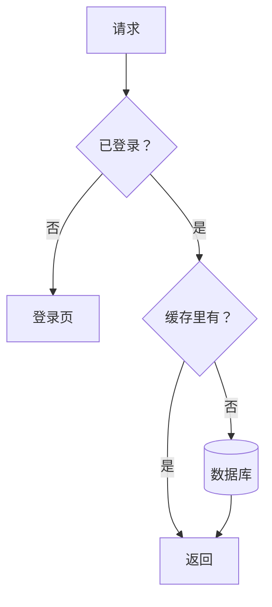
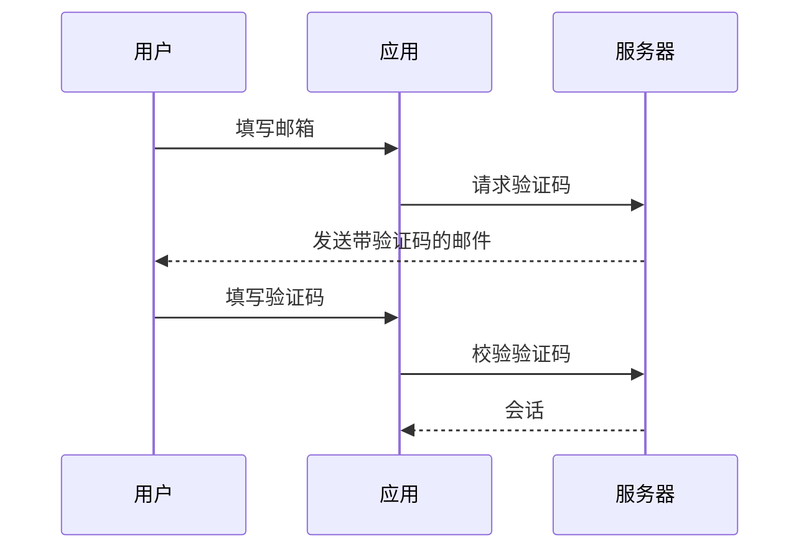

# Mermaid 图

回复里的 ```mermaid 块渲染成一张图，随你写下的行逐行画出来。排版由渲染器负责，你只写结构 —— 节点、连线、标注 —— 一个坐标都不用写。所以它适合那些版式读者早就料到的图；当摆法本身就是论点时，它就是错的块（见 `SKILL.md` 里那张表）。

## 什么时候写

| 要回答的问题 | 图 |
|---|---|
| 会发生什么，带分支或循环 | `flowchart` |
| 谁按什么顺序给谁发了什么 | `sequenceDiagram` |
| 有哪些状态，之间怎么切换 | `stateDiagram-v2` |
| 有哪些东西，彼此什么关系 | `erDiagram`、`classDiagram` |
| 什么时候做什么，做多久 | `gantt`、`timeline` |

一排 3–5 个阶段、没有分支，手画 ```svg 更清楚；一串选项是表格，不是图。

## 契约

渲染器是 pele：读 Mermaid 语法（12.1 版），用它自己的排版和应用的主题。

- **不写自己的颜色。** 不写 `style`、不写带颜色的 `classDef`、不写 `linkStyle`、不写 `%%{init}%%` 主题或 `themeVariables`。每张图的颜色都由主题给；你写的颜色是写死的，换个主题就坏。
- **至多一处突出：`:::accent`**，挂在要紧的那一个节点上 —— 风险、改动、答案。颜色由应用按主题给。别的都不突出。
- **用 `accTitle:` 起名**，说这张图画的是什么 —— 那就是它的标题，相当于 ```svg 图的 `aria-label`。不要 frontmatter 的 `title:`：它会在图里画一行标题，而标题属于你在图前面写的那句话。
- **标注是纯文本。** 含标点的标注加引号：`A["call(x)"]`。`<br>` 换行；别的 HTML 一概不认。
- **不带出图外的东西**：`click` 链接和图片都不会画。
- 不可用：ZenUML 等插件图型。

回复写完后如果块变成了错误卡，错误信息会指出是哪一行：改好之后把整个块重写一遍。要改一张已经写过的图，就写改好的那个块 —— 它很短。

## 预算

用来讲清楚的图，仍然要比它讲的东西小。渲染器让多画一个节点几乎不花代价，正因为这样，数量更需要一个上限。

- 流程、状态、实体、类图**最多 10 个节点**。
- 时序图**最多 5 个参与方、12 条消息**；排期**最多 12 项任务**。
- **标注是短语**：大约 5 个英文单词，或 10 个汉字。
- **连线标注只在两端说不清时才写**，最多 3 个词。

超过了：先写总览 —— 只有主干 —— 再为要紧的部分各写一张小图；或者只写总览，问用户要展开哪一块。和 `references/diagrams.md` 是同一条规矩。

## 排版

- **方向**：最多 4 步的短流水线用 `flowchart LR`，更长或带分支的用 `flowchart TD`。栏宽大约 640；放不下的长横链会被改成竖排。
- **节点 id 用短 ASCII**（`plan`、`ship`），文字放在标注里。
- **`subgraph` 只在分组本身是答案的一部分时用**，只套一层。
- **先写主干**：按读者走的顺序写节点和连线。图是随你的行到达逐行画出来的，先写的就是读者先看到的。

## 两张小图



六个节点、一个方向、短标注；连线标注在那里，是因为「是 / 否」从两端看不出来；数据库被突出，因为问题问的就是它。



三个参与方、六条消息，回应用虚线箭头。
